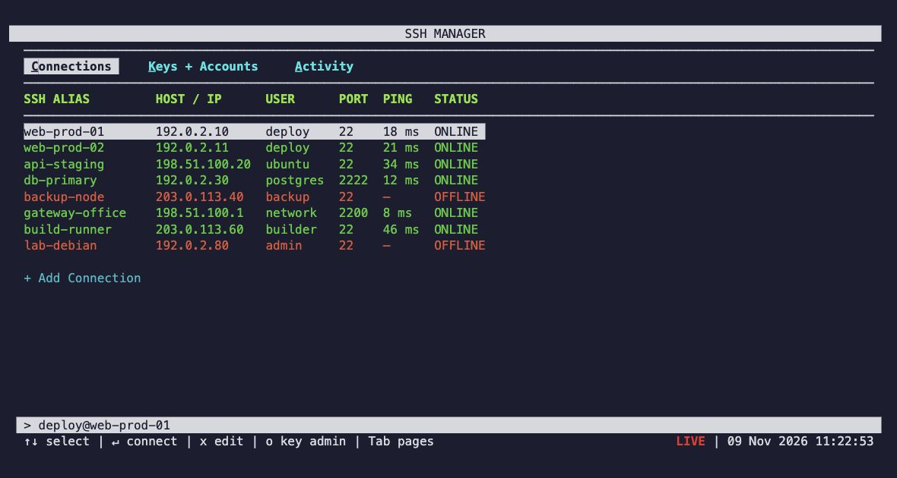
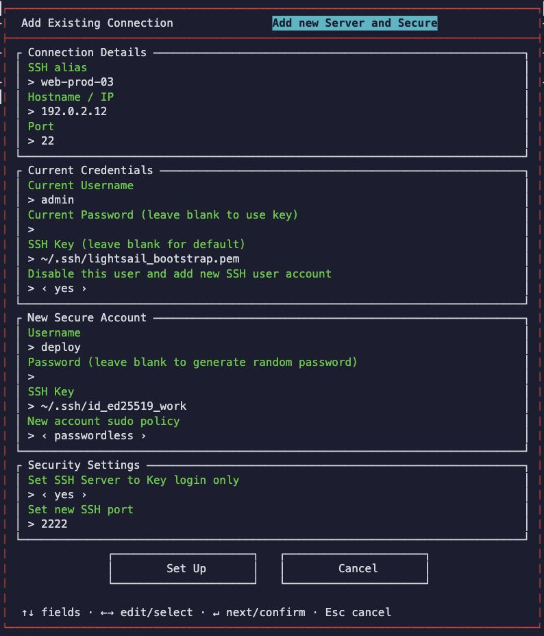

# SSH Manager

Terminal SSH connection and key manager. Reads `~/.ssh/config`.

- Connections and live availability checks
- SSH key generation, import, authorisation and rotation
- Debian/Ubuntu secure setup with recovery rollback
- Saved account passwords encrypted using the OS keyring





## Install

Requires [uv](https://docs.astral.sh/uv/), OpenSSH and an available OS keyring.

```sh
uv tool install --python 3.12 git+https://github.com/cfarrants/ssh-manager.git
ssh-manager
```

Tested on macOS. Linux needs Secret Service or KWallet; Windows support is untested.
The OS may request permission to access its keyring.

## Development

```sh
uv sync
uv run pytest
uv run ssh-manager
```

Beta software. Test administration changes on a disposable server first.
